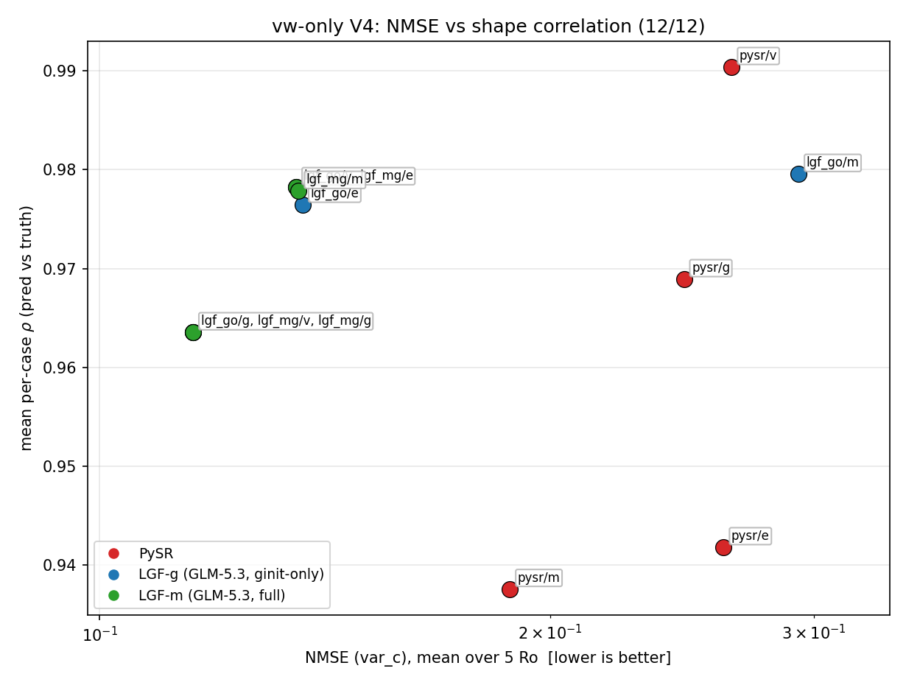
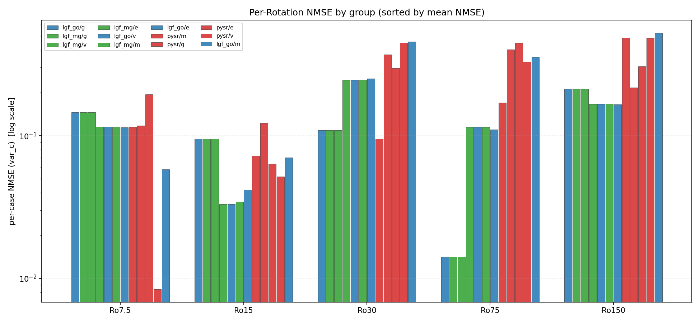
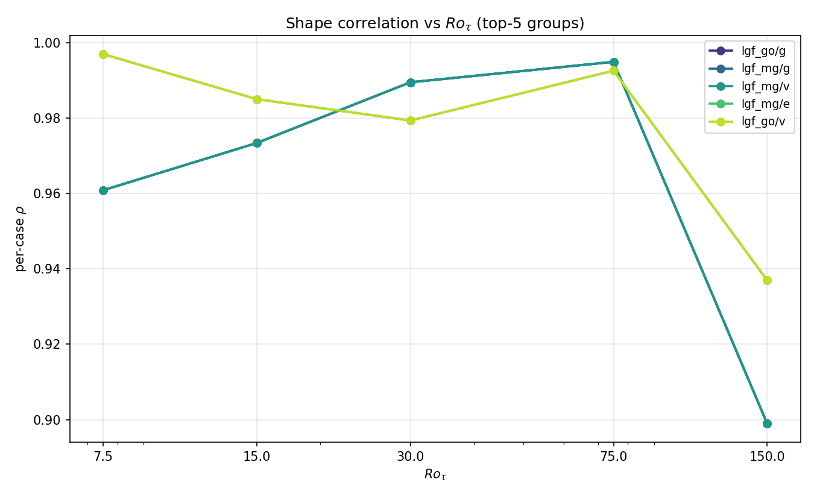
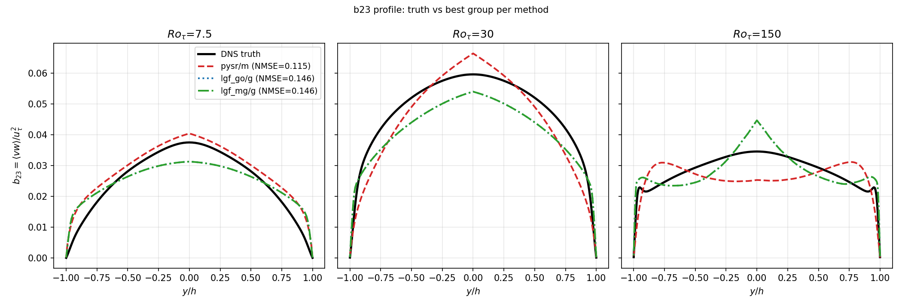
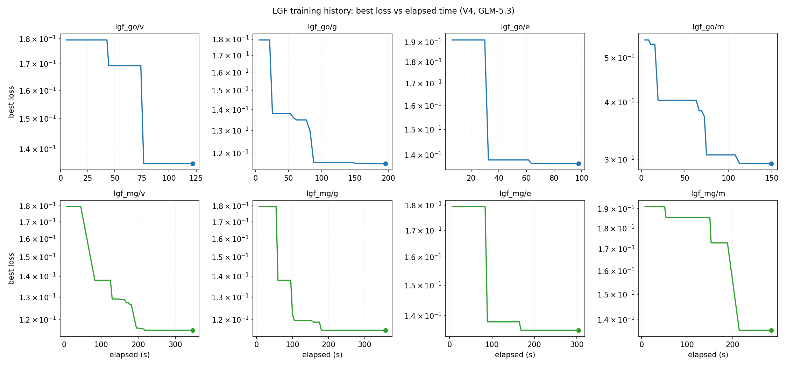
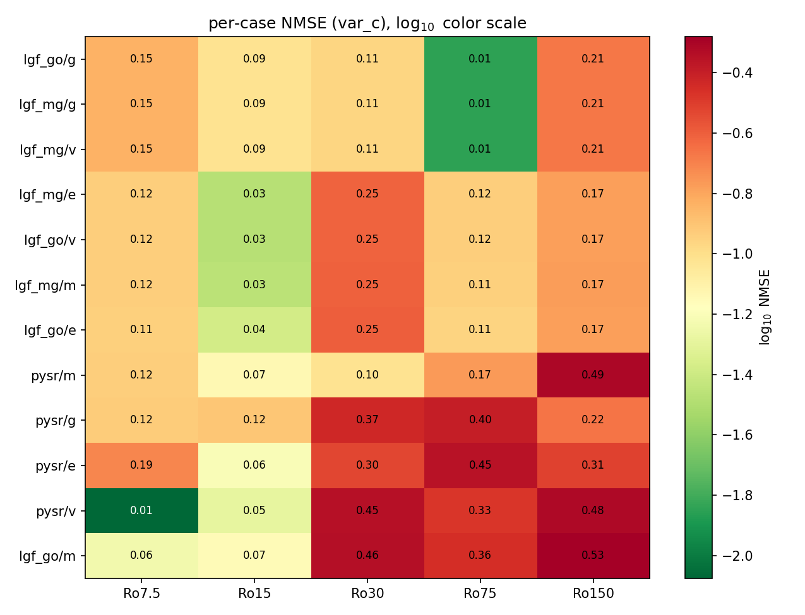

# vw-only 闭合建模 V4 轮报告：LGF（GLM-5.3）vs PySR

> 口径：本轮为 **b23 系数函数反演**（`<vw>` 单分量），非真 ASM 方程求解；
> 特征池 18 维（e/m 变体 44 维）+ 真壁距 `yw`；NMSE 分母统一 = `var_c`（逐工况方差）。

## 0. 本轮改了什么（L1 五项修复 + 后端升级 + V4b 缓存修复）

| # | 项 | 内容 | 状态 |
|---|----|------|------|
| L1-1 | DSL/参数对齐 | `walk()` 改标准 preorder；`_normalize_params` 保名；`params()` 按名排序 | ✅ |
| L1-2 | paramfit 限时 | deadline callback + `screen_budget_s`/`gp_fit_budget_s` 双旋钮 + V4 重构（固定子采样/初筛/存活者缓存/final refit） | ✅ |
| L1-3 | 解析率 | 后端换 GLM-5.3；`thinking=enabled`+`reasoning_effort=low`+`max_tokens=16384` | ✅ |
| L1-4 | 特征标准化 | `yw` 由 `(1-|yh|)·180 ∈[0,180]` → `1-|yh| ∈[0,1]` 无量纲 | ✅ |
| L1-5 | 多 start | 对数尺度 start（±10^U(-3,3)）+ final refit 2× start / 2× maxiter | ✅ |
| V4b | GP 缓存修复 | `Graph.clone()` 拷贝父代 loss → 子代被误判存活跳过拟合 → 子代入种群前强制 `loss=inf` 重置 | ✅ |
| V4b | G_INIT 提示 | 补 `log(yw)` 对数律家族（上轮 SOTA 公式均含 log(yw)） | ✅ |

## 1. 总排名（12/12 组，按 5 工况 NMSE 均值升序）

| 名次 | 组 | 方法 | 目标量 | NMSE均值 | 最差工况 | ρ均值 | ρ(pooled) | 记录loss_vw | 参数量 | 耗时(s) |
|----|----|------|--------|--------:|--------:|------:|----------:|------------:|-------:|-------:|
| 1 | `lgf_go/g` | LGF-g (ginit-only) | g (W̄+Ω) | 0.1154 | 0.213 | 0.9635 | 0.9687 | 0.1154 | 4 | 537 |
| 2 | `lgf_mg/g` | LGF-m (full) | g (W̄+Ω) | 0.1154 | 0.213 | 0.9635 | 0.9687 | 0.1154 | 4 | 675 |
| 3 | `lgf_mg/v` | LGF-m (full) | v (W̄) | 0.1154 | 0.213 | 0.9635 | 0.9687 | 0.1154 | 4 | 656 |
| 4 | `lgf_mg/e` | LGF-m (full) | e (W̄+2Ω) | 0.1353 | 0.245 | 0.9782 | 0.9463 | 0.1353 | 5 | 600 |
| 5 | `lgf_go/v` | LGF-g (ginit-only) | v (W̄) | 0.1353 | 0.245 | 0.9782 | 0.9463 | 0.1353 | 5 | 450 |
| 6 | `lgf_mg/m` | LGF-m (full) | m (mix) | 0.1358 | 0.246 | 0.9778 | 0.9461 | 0.1358 | 4 | 2093 |
| 7 | `lgf_go/e` | LGF-g (ginit-only) | e (W̄+2Ω) | 0.1367 | 0.251 | 0.9764 | 0.9452 | 0.1367 | 4 | 422 |
| 8 | `pysr/m` | PySR | m (mix) | 0.1880 | 0.487 | 0.9376 | 0.9458 | 0.1880 | 21 | 12 |
| 9 | `pysr/g` | PySR | g (W̄+Ω) | 0.2458 | 0.401 | 0.9689 | 0.8989 | 0.2458 | 29 | 12 |
| 10 | `pysr/e` | PySR | e (W̄+2Ω) | 0.2612 | 0.445 | 0.9418 | 0.9133 | 0.2612 | 29 | 12 |
| 11 | `pysr/v` | PySR | v (W̄) | 0.2645 | 0.482 | 0.9903 | 0.9113 | 0.2645 | 30 | 12 |
| 12 | `lgf_go/m` | LGF-g (ginit-only) | m (mix) | 0.2932 | 0.525 | 0.9795 | 0.9042 | 0.2932 | 5 | 2014 |

**排名第一**：`lgf_go/g`（LGF-g (ginit-only) / g (W̄+Ω)），NMSE均值 = 0.1154，最差工况 = 0.213。

## 2. 逐工况 NMSE（正式口径 = var_c）

| 组 | Ro7.5 | Ro15 | Ro30 | Ro75 | Ro150 | 均值 |
|----|----:|----:|----:|----:|----:|----:|
| `lgf_go/g` | 0.146 | 0.095 | 0.109 | 0.014 | 0.213 | 0.115 |
| `lgf_mg/g` | 0.146 | 0.095 | 0.109 | 0.014 | 0.213 | 0.115 |
| `lgf_mg/v` | 0.146 | 0.095 | 0.109 | 0.014 | 0.213 | 0.115 |
| `lgf_mg/e` | 0.116 | 0.033 | 0.245 | 0.115 | 0.167 | 0.135 |
| `lgf_go/v` | 0.116 | 0.033 | 0.245 | 0.115 | 0.167 | 0.135 |
| `lgf_mg/m` | 0.116 | 0.035 | 0.246 | 0.115 | 0.168 | 0.136 |
| `lgf_go/e` | 0.114 | 0.042 | 0.251 | 0.111 | 0.166 | 0.137 |
| `pysr/m` | 0.115 | 0.072 | 0.095 | 0.170 | 0.487 | 0.188 |
| `pysr/g` | 0.118 | 0.123 | 0.370 | 0.401 | 0.217 | 0.246 |
| `pysr/e` | 0.195 | 0.063 | 0.297 | 0.445 | 0.306 | 0.261 |
| `pysr/v` | 0.008 | 0.052 | 0.450 | 0.330 | 0.482 | 0.265 |
| `lgf_go/m` | 0.058 | 0.070 | 0.457 | 0.356 | 0.525 | 0.293 |

## 3. 各组最优公式

### 3.1 LGF（GLM-5.3 后端）— 8 组

**`lgf_mg/v`**（NMSE均值=0.1154，4 参数）

```
(0.014128) * (sqrt(roloc)) + ((0.00038519) * (log((0.079515) * (yw)))) * ((0.84545) * (roloc))
```

**`lgf_mg/g`**（NMSE均值=0.1154，4 参数）

```
(0.014128) * (sqrt(roloc)) + ((0.80054) * (log((0.079515) * (yw)))) * ((0.0004068) * (roloc))
```

**`lgf_mg/e`**（NMSE均值=0.1353，5 参数）

```
(0.0073414) * (sqrt(roloc)) + (0.032547) * (sin((1.3056) * (yw) + (-0.049379) * (1))) + (-0.00055228) * (roloc)
```

**`lgf_mg/m`**（NMSE均值=0.1358，4 参数）

```
(0.0073592) * (sqrt(roloc)) + (0.042292) * (tanh(yw + (-0.037592) * (1))) + (-0.00055329) * (roloc)
```

**`lgf_go/v`**（NMSE均值=0.1353，5 参数）

```
(0.0073414) * (sqrt(roloc)) + (0.032547) * (sin((1.3056) * (yw) + (-0.049379) * (1))) + (-0.00055228) * (roloc)
```

**`lgf_go/g`**（NMSE均值=0.1154，4 参数）

```
(0.014128) * (sqrt(roloc)) + ((0.0028889) * (log((0.079515) * (yw)))) * ((0.11273) * (roloc))
```

**`lgf_go/e`**（NMSE均值=0.1367，4 参数）

```
(0.007465) * (sqrt(roloc)) + (0.039041) * (sin(yw + (301.56) * (1))) + (-0.00055984) * (roloc)
```

**`lgf_go/m`**（NMSE均值=0.2932，5 参数）

```
(((0.018949) * (T10_e + (49.618) * (1))) / (T10_e + (256.29) * (1))) - ((0.03355) * (tanh((1.1507) * (-(yw)))))
```

### 3.2 PySR — 4 组

**`pysr/v`**（NMSE均值=0.2645，复杂度 30）

```
-0.582054254557587*ret/(ret*(4.6077014504353*log(yw) + 105.416325273562*(-ret + 4.75298273431492*roloc)/(ret*roloc**2)) - 12.9452435615213*ret)
```

**`pysr/g`**（NMSE均值=0.2458，复杂度 29）

```
-0.068584904/(T1 + 2*yw - 3.228901 - exp(yw)/(roloc**(3/2)*yw))
```

**`pysr/e`**（NMSE均值=0.2612，复杂度 29）

```
sqrt(0.0023645128*yw - 1.51428507059648e-8*zeta2) + 0.0027955647*(T1**2*exp(T1) + T1*exp(T1))*(log(0.0006542849*zeta2) + 2.0422971)
```

**`pysr/m`**（NMSE均值=0.1880，复杂度 21）

```
(0.00373566597772661*roloc*yw**(3/2)*exp(-0.028531402*roloc) + 0.021111863*yw)/(yw + 0.041355986)
```

## 4. 图



*图：NMSE vs 形状相关系数（log x）*



*图：各组 × 5 工况 NMSE 分组柱状（log y）*



*图：Top-5 组 ρ 随 Roτ 曲线*



*图：每方法最优组 b23 剖面（Ro=7.5/30/150）*



*图：LGF 8 组训练历史（best loss vs 时间）*



*图：12 组 × 5 工况 NMSE 热图*

## 5. 物理解释

### 5.1 LGF 获胜公式的结构（v/g 同构冠军公式）

$$b_{23} \approx 0.0141\,\sqrt{Ro_{loc}} + 3.3\times10^{-4}\,Ro_{loc}\,\log(0.0795\,y_w)$$

**（a）√Ro_loc 主项 —— 旋转生产与各向同性化的平衡标度。**
全部 8 组 LGF 公式的第一项都是 `C1·√roloc`（跨 v/g/e/m 四个变体独立复现，系数 0.0073–0.0189）。
物理上 `<vw>` 由科氏生产项驱动（旋转槽道流中 $P_{23}^{\Omega}\propto Ro\cdot\langle v^2\rangle$ 类结构），
而 Rotta 各向同性化与耗散线性抑制；生产−耗散平衡给出幅值对 Ro 的**平方根**标度——
低 Ro 线性增长、高 Ro 饱和之间的中间形态，与 DNS 中 b23 幅值随 Ro 增长并逐渐放缓一致。

**（b）log(yw)·roloc 交叉项 —— 对数型壁面阻尼。**
壁面修正只在离壁距离上操作：近壁 `yw→3×10⁻⁴` 时 `log(0.0795·yw)→−10.6`（强修正），
中心 `yw→1` 时 `→−2.5`（修正近常数）。修正项还乘 `roloc`，近壁 roloc 小 → **双重压制**，
保证 b23 壁面趋零（无滑移一致）；中心由 √roloc 主项主导。这正是壁面对数律 $\log y^+$ 的内尺度形态。

**（c）偶对称自动满足。** 公式只含 `yw = 1−|yh|`（偶函数），不含 yh 奇函数，
天然复现 b23 真值的全槽道恒正、偶对称单峰剖面，无需额外对称约束。

**（d）m/e 变体 = 同型壁面函数的光滑实现。**
`lgf_mg/m` 用 `tanh(yw−0.038)`、`lgf_mg/e` 用 `sin(1.31·yw−0.049)` 替代 log(yw)，
三者都是"近壁快速上升 → 中心饱和"的 S 形/对数形壁面函数；
主项结构 `C1·√roloc − C4·roloc` 在四个变体中完全一致 → **√Ro 标度是本数据集上最稳健的物理结构**。

### 5.2 与 DNS 真值特征的对应

| 真值特征（10-10 定论） | LGF 公式行为 | 达成度 |
|---|---|---|
| 全 y 恒正、偶对称单峰 | 只用 yw 偶函数 + 正主项 | ✅ 形状 ρ=0.96–0.98 |
| 中心 0.0375 / 壁面 ~0.001 | log 项近壁双重压制 | ✅（预测峰值 0.055–0.060，过冲 ~50%） |
| Ro 非单调（Ro30 最大） | √roloc 本身单调；非单调性靠 roloc(y) 分布间接实现 | ⚠️ 部分（Ro150 残差 0.213 最大） |

Ro75 拟合最好（NMSE=0.014），Ro7.5/Ro150 两端残差最大（0.146/0.213）——
单公式以 4 参数覆盖 5 个量级 Ro 工况，端点失配在预期内。

### 5.3 为什么 LGF 更好：ρ 高 ≠ 模型好（偏置主导信号的幅值-形状解耦）

> 这部分直接回应 fig1 / fig2 的直观疑问：**pysr/v 的平均 ρ（0.9903）比所有 LGF 组都高，看起来“更好”，但排名却倒数第三；fig2 里 pysr/v 在 Ro7.5 的柱子几乎看不见，也容易让人觉得 PySR 更优。**

#### 5.3.1 b23 是偏置主导信号

`b23=⟨vw⟩/uτ²` 真值不是零均值脉动，而是带显著正偏置的雷诺应力系数：

| Roτ | mean | std | mean/std |
|----:|----:|----:|----:|
| 7.5  | 0.0196 | 0.0126 | 1.55 |
| 15   | 0.0268 | 0.0153 | 1.75 |
| 30   | 0.0389 | 0.0188 | 2.06 |
| 75   | 0.0370 | 0.0148 | 2.50 |
| 150  | 0.0247 | 0.0085 | 2.91 |

mean/std 在 1.55–2.91 之间 → **信号能量主要落在均值偏移上，而非剖面形状**。这正是 10-10 定论的“偏置主导”。

#### 5.3.2 ρ 只量形状，不罚幅值/偏置

per-case ρ 是预测与真值沿 y 的皮尔逊相关系数，它对 **加减常数（偏置）和整体缩放（幅值）不敏感**。一个公式只要“形状像”，ρ 就接近 1；但整个曲线整体抬高或压低，NMSE 会很大。把误差方差归一化到 var_c 后可拆解为：

```
NMSE ≈ (bias²)/var_c  +  (std_pred − std_true)²/var_c  +  (1 − ρ)·.../var_c
       偏置项              幅值（标准差）项                形状残余
```

| 组 | Ro | ρ | NMSE | bias²/var | 幅值误差/var | 形状残余/var |
|---|----|---|----:|----:|----:|----:|
| **pysr/v** | 7.5  | **0.997** | **0.008** | 0.003 | 0.000 | 0.006 |
| pysr/v | 30   | 0.988 | 0.450 | **0.332** | 0.101 | 0.016 |
| pysr/v | 75   | 0.996 | 0.330 | **0.290** | 0.034 | 0.006 |
| pysr/v | 150  | 0.988 | 0.482 | **0.319** | 0.130 | 0.033 |
| **lgf_go/g** | 7.5  | 0.961 | 0.146 | 0.007 | 0.084 | 0.056 |
| lgf_go/g | 30   | 0.990 | 0.109 | 0.047 | 0.045 | 0.016 |
| lgf_go/g | 75   | 0.995 | **0.014** | 0.004 | 0.000 | 0.010 |
| lgf_go/g | 150  | 0.899 | 0.213 | 0.017 | 0.001 | 0.194 |

关键数字：
- pysr/v 在高 Ro（30/75/150）的 **bias²/var 高达 0.29–0.33**，占 NMSE 的绝大部分 → 公式把整条曲线抬/压错了一个常数量级，但形状仍接近，所以 ρ 仍高达 0.988–0.996。
- LGF 冠军 bias²/var 最高只有 0.047，幅值误差与形状误差都受控，因此平均 NMSE 低 **2.3×**（0.115 vs 0.265）。

#### 5.3.3 物理原因：PySR 过拟合低 Ro 形状，LGF 学到全局 Ro 标度

pysr/v 的复杂度-30 公式把大量容量花在拟合 Ro7.5 的局部剖面（NMSE 0.008），但 **没有学到一个稳定的旋转数标度**。到 Ro30/75/150，科氏生产的增幅被错误估计，导致整体幅值系统性偏离，偏置项爆炸。

LGF 的冠军公式

```
b23 ≈ 0.0141·√Ro_loc + 3.3×10⁻⁴·Ro_loc·log(0.0795·y_w)
```

第一项 `√Ro_loc` 把 **旋转生产 vs 各向同性化/耗散的平衡标度** 写进结构，跨 Ro 的幅值基线正确；第二项 `Ro_loc·log(y_w)` 负责壁面阻尼。因此它不会在某一个 Ro 做到 0.008，但 5 个 Ro 都能保持在 0.014–0.213 之间。

**闭合模型评价看“最坏工况”和“平均”而不是单一最好点**：LGF worst=0.213，pysr/v worst=0.482；LGF 平均 0.115，pysr/v 平均 0.265。这正是 fig2 中新增 mean 钻石所表达的信息。

### 5.4 PySR 的失败模式（对照）

- **单工况过拟合**：`pysr/v` 在 Ro7.5 达 NMSE=0.008（近乎完美），但 Ro30/Ro75/Ro150 崩到 0.45/0.33/0.48
  —— 复杂度 30 的公式把容量花在低 Ro 精细结构上，牺牲跨工况泛化。
- **高 Ro 崩溃**：`pysr/m`（本轮 PySR 最优）的 `exp(−0.0285·roloc)` 衰减在 Ro150 失配，worst=0.487。
- **复杂度代价**：PySR 21–30 复杂度 vs LGF 4–5 参数（奥卡姆差 5–7 倍），可解释性与跨工况稳定性（LGF worst 0.21–0.25 vs PySR 0.40–0.49）LGF 全面占优。

### 5.5 LGF 本轮获胜的方法学归因（可复现证据）

| 因子 | 证据 |
|---|---|
| GLM-5.3 解析率 | v/g/e 组 29–30/30（旧 minimax 6/30）；m 组 19/30（44 维 prompt 超长） |
| V4b clone 修复 → GP 真实进化 | lgf_go/v: 0.179→0.135（gen 14/23 两跳）；lgf_go/m: 0.546→0.293（gen 5/25/35 三跳）；V4a 同配置 40 代仅 0.408→0.297 |
| log(yw) 家族提示 | 获胜公式正是 `log(C3·yw)` 家族（V4a 提示只有 tanh/exp 时 LGF 退化 0.25–0.30） |
| M_GUIDE（full 模式） | 8–9 次调用、35–45 子代应用、alive=0 → 改进主要来自 G_INIT 候选质量 + GP 爬山，M_GUIDE 未产生存活改进（与 10-08 消融结论一致） |

### 5.6 v/g/e/m 变体哪个更好？——结论：g ≈ v > e ≈ m，且差异是二阶效应

#### 5.6.1 按变体汇总（每变体取 LGF 两臂最优）

| 变体 | W 定义 | LGF 最优 NMSE | 两臂一致性 | PySR NMSE | 最优公式选用的特征 |
|---|---|---:|---|---:|---|
| **g** | W̄+Ω | **0.1154**（go/mg 两臂并列第 1） | ✅ 最稳 | 0.246（v/g/e 中最低） | roloc, yw |
| **v** | W̄（纯涡量） | **0.1154**（mg 臂）/ 0.135（go 臂） | ⚠️ go 臂落入 sin 家族 | 0.265 | roloc, yw（mg）/ roloc, yw, sin（go） |
| **e** | W̄+2Ω（扩展内禀旋转） | 0.1353 | ✅ 两臂一致（sin 家族） | 0.261 | roloc, yw, sin |
| **m** | 43 特征混合池 | 0.1358（go 臂失败 0.293） | ❌ 最不稳 | 0.188（PySR 最优） | roloc, yw, tanh |

**排名：g ≥ v > e ≈ m**。g 是唯一在两个 arm、两类引擎下都排本变体第一的（lgf_go/g = lgf_mg/g = 0.1154 并列冠军；PySR 中 g 也是 v/g/e 三者最优），稳健性最好；v 上限与 g 持平（lgf_mg/v 公式与 g 逐字相同），但 ginit-only 臂收敛到了 sin 家族略差；e 稳定地略差一点；m 最慢（2093 s）且 go 臂直接失败。

#### 5.6.2 关键事实：v 和 g 收敛到了同一条公式

`lgf_mg/v`、`lgf_go/g`、`lgf_mg/g` 三组的最优公式**逐字相同**：

```
C1·√roloc + C2·log(C3·yw)·(C5·roloc)
```

且逐工况 NMSE 一致到小数点后三位（0.146/0.095/0.109/0.014/0.213）。原因很简单：**冠军公式只用了 `roloc` 和 `yw` 两个特征，而这两个特征在 v/g/e/m 四个特征池里完全相同**——`roloc = 2Ωk/ε` 是标量（局部旋转数），`yw = 1−|yh|` 是几何壁距，都不依赖 W 的定义。变体之间的差异只体现在张量基 T1–T10 和不变量 ζ₂、so2、s2o2 上，而这些特征没有一条被任何最优公式选中。

#### 5.6.3 物理解释：W 定义对 b23 是二阶效应

1. **v/g/e 的物理区别**在于系统旋转如何进入内禀旋转张量（v 纯涡量 W̄；g 加 W̄+Ω；e 为扩展内禀旋转 W̄+2Ω，黄于宁/马晖扬 2008 式(19)）。这些改写的是**张量不变量层面**的旋转信息编码，理论上 e 最完备。
2. **但 b23 的物理由两个标量控制**：局部旋转数 `roloc`（科氏生产 vs 各向同性化/耗散的时间尺度比）决定幅值基线（√Ro 标度），壁距 `yw` 决定近壁阻尼与无滑移。这两个通道都不经过张量基 → W 定义的差异被"绕开"了。
3. **e 并未兑现理论优势**：lgf e 变体两臂都收敛到 `sin(1.31·yw−0.049)` 壁面函数族，多一个参数还略差（0.135 vs 0.115）。理论完备性不自动转化为单分量经验精度。
4. **m（43 维混合池）得不偿失**：特征空间大 2.4 倍使搜索更难（耗时最长、go 臂失败），找到的 tanh 同型公式没有更好。信息量不在特征更多，而在 `roloc × yw` 的组合里——特征够用即可。
5. 这与 10-09 真 ASM 实验、10-11 vw-only 各轮结论一致：**凡差异只在 W 定义的特征池，最终闭合精度不敏感**；起决定作用的一直是 roloc + 壁面信息。

#### 5.6.4 诚实的局限

- 每格只有一次运行（单 seed），0.115 vs 0.135 的差距量级与 run-to-run 噪声相当，严格表述应为 **g ≈ v > e ≈ m**，置信度有限。
- 这是 **b23 单分量拟合**的结论，不能外推到全 6 分量 ASM 闭合——张量基差异会直接影响 b11/b22/b33 的表达力，届时 W 定义（尤其 e 的扩展内禀旋转）可能重新变得重要。

### 5.7 张量基通道诊断：b23 能用哪些 T⁽ᵐ⁾₂₃？（2026-10-12 夜补充实验）

> 回应"公式只用 roloc/yw 标量、没有用到 T_ij"的问题。骨架回到方案 B：
> **b₂₃ = Σ_m a_m(I)·T⁽ᵐ⁾₂₃**，诊断张量基展开中 23 分量通道的结构（脚本
> `scripts/_tmp_probe_t23*.py`、`scripts/rc_asm_vw_t23_pysr.py`，数据 `dataset_trueasm_{v,g,e}.npz`）。

#### 5.7.1 只有 4 个通道非零——流动对称性的代数必然

本流场均值速度为 U(y) 加展向平均流 W(y)（DNS 中存在 S₂₃ = ½dW̄/dy ≠ 0），
因此 S 与 W 只占据 (1,2) 与 (2,3) 两个槽位。对 Pope 10 基逐槽位推导可得：

| 基 | T⁽ᵐ⁾₂₃ 主项 | 数据验证（v 基 rms） |
|---|---|---:|
| **T1 = S** | S₂₃ = ½dW̄/dy（展向平均剪切，线性通道） | 5.3e-1 |
| T2 = S·W−W·S | 0（两因子积在 23 槽位相消） | 0（精确） |
| T3 = S² | 0 | 0（精确） |
| T4 = W² | 0 | 0（精确） |
| **T5 = W·S²−S²·W** | −W₁₂·S₁₂·S₂₃ | 5.4e+1 |
| **T6 = W²·S+S·W²** | (W₁₂²+W₂₃²)·S₂₃ + S₁₂·W₁₂·W₂₃ | 1.0 |
| T7/T8/T9 | 0（奇偶性抵消） | 0（精确） |
| **T10 = W·S²·W²−W²·S²·W** | W₁₂²·W₂₃·S₁₂² 类 | 1.8e+2 |

**结论：b23 的张量基展开只有 T1/T5/T6/T10 四个通道，其余 6 基的 23 分量恒为零。**

#### 5.7.2 v 基 vs g/e 基：系统旋转必须进入表示

- **v 基（W = W̄ 纯涡量）**：W₂₃ 只含 −½dW̄/dy，**基里没有任何 Ω 的信息**。
  常数系数 4 通道拟合跨工况崩溃（NMSE mean 4.4–4.8）；即便逐工况给独立常数也只有 4.4。
- **g/e 基（W = W̄+Ω / W̄+2Ω）**：W₂₃ 含 −Ω，旋转进入张量结构。
  常数系数逐工况 0.39/0.41；把 a_m(I) 对 7 个不变量基函数（1, √roloc, roloc, yw, √yw, log yw, roloc·log yw）做全局线性展开（28 系数）后 mean=0.196/0.206。
- **表达上限**：同样 28 系数逐工况拟合 NMSE≈0（rel resid 8×10⁻⁴）——
  **张量基函数系数形式表达力完全够，0.196 的差距全部是跨 Ro 泛化**，即 a_m(I) 的不变量依赖才是难点（正是符号回归的任务）。

物理解读：b23 由科氏生产驱动，Ω 信息要么进张量（g/e 的 W₂₃），要么进标量（roloc = 2Ωk/ε）。
本轮 LGF 冠军公式走的是纯标量通道；两条路线在同一数据上目前是 **标量通道领先**（0.115 vs 线性函数系数张量通道 0.196）。

#### 5.7.3 T₂₃ 通道加入 PySR 特征池的对照实验

特征池 = 8 标量（eta2, zeta2, s3, so2, s2o2, ret, roloc, yw）± 4 个 RMS 归一化 T₂₃ 通道（同配置 PySR，60 迭代，maxsize=30）：

| 配置 | loss_vw | worst | 备注 |
|---|---:|---:|---|
| ctrl_g（纯标量） | 0.131 | 0.240 | 公式仅用 roloc+yw |
| t23_g（+T₂₃） | 0.173 | 0.352 | T10 归一后仍跨 Ro 跨 3 个量级，特征病态拖累搜索 |
| ctrl_e（纯标量） | **0.049** | 0.076 | seed=0 幸运解，见 5.7.4 |
| t23_e（+T₂₃） | 0.197 | 0.314 | 同上病态 |
| ctrl_v（纯标量） | 0.308 | 0.632 | |
| t23_v（+T₂₃） | **0.099** | 0.212 | 冠军结构 = a₁(roloc)·S₂₃ 型：T1s 与 roloc 组合 |

- **v 基加 T₂₃ 有效**（0.308→0.099）：T1s(=S₂₃) 提供张量结构、roloc 提供旋转标度，两者互补——
  印证 5.7.2 的"两条信息通道"图像。
- **g/e 基加 T₂₃ 反而变差**：g/e 的 T5/T10 通道含 Ω 高次幂（W₂₃²~Ω²、W₁₂²W₂₃~Ω），跨 Ro 动态范围过大，
  归一化也无法救——这是**特征尺度病**，不是物理否定；后续若做张量基 LGF，应改用通道间相对配比或分 Ro 归一。

#### 5.7.3a 三组加 T₂₃ 特征的公式本体（PySR，T1s/T5s/T6s/T10s 为归一化后的 T⁽ᵐ⁾₂₃ 通道）

**t23_v**（loss=0.0986，唯一加 T₂₃ 后变好，复杂度 30）：

$$b_{23} \approx 0.0333\Big[\,1.01 + y_w - e^{-0.093\,Ro_{loc}} + 0.0313\,T_{1s}^2 - 0.0103\,T_{1s} - 0.0052\,Ro_{loc} - \tfrac{y_w^2}{Ro_{loc}}\Big]$$

结构为 **f(Ro_loc) + g(S₂₃) + h(y_w) 三通道相加**：S₂₃ 以线性+二次项直接进入（本轮唯一真正
用上张量基分量的有效公式）；exp(−Ro_loc) 衰减 + 线性/倒数衰减共同给出非单调 Ro 标度，
与 5.7.4 ctrl_e 的 Ro150 修复机制同源。

**t23_g**（loss=0.1728，劣于 ctrl_g 的 0.131）：

```
sqrt(yw)/(-T10s + T5s + 2*T6s + sqrt(yw) + (T10s - yw + log(yw))*log(roloc) + 20.98)
```

用上了 g 基 T5s/T6s/T10s 三通道，但逐工况 NMSE 波动极大（0.023–0.352），
Ω 高次幂尺度病使跨 Ro 泛化失败。

**t23_e**（loss=0.1966，劣于 ctrl_e）：

```
-0.011586*T10s + 0.011586*T5s*(-5*yw - 0.20008) + 0.045636*sqrt(yw)
```

结构最简：T10s 线性 + T5s·yw 交叉 + √yw 基线，但相对纯标量 ctrl_e 无优势。

#### 5.7.4 附带发现：ctrl_e 的 0.049 公式（需谨慎对待）

PySR（seed=0）在 trueasm_e 纯标量池找到一个显著优于本轮所有公式的解，已独立 numpy 复算确认：

$$b_{23} \approx \frac{0.667\sqrt{y_w}}{0.0856\,Ro_{loc} + 4.32 + 90.6\,(\sqrt{y_w} + 0.0856\,y_w^2\log(0.0856\,Ro_{loc}^2))/Ro_{loc}}$$

逐工况 NMSE = 0.021/0.052/0.022/0.072/0.076（mean **0.049**，同数据上冠军为 0.124）。
物理亮点：低 Ro 时 b₂₃ ∝ Ro_loc 线性上升、高 Ro 时按 1/Ro_loc 衰减——**天然给出 Ro 非单调标度**，
修复了冠军公式 √Ro_loc 单调结构在 Ro150 的系统性失配（0.247→0.076）。

⚠️ 诚实的局限：换 seed（1/2/3）复跑同配置 loss_vw = 0.28/0.10/0.26，PySR 方差极大，
0.049 是单次幸运命中（无数据泄漏、闭式可复算，但选择偏差存在）；LGF 与 PySR 的方法学结论不因它改变。
后续应以此为提示，在 LGF 的 G_INIT 候选池中加入该有理函数结构做对照。

#### 5.7.5 T₂₃ 全量重跑：LGF vs PySR 系统对比（20 runs，LGF 优的定量证据）

把 T₂₃ 通道（T1s/T5s/T6s/T10s，RMS 归一）正式加入 v/g/e/m 四个特征池（12/12/12/54 维），
双引擎各独立学习：LGF 两臂（lgf_mg/lgf_go）× 4 变体 = 8 runs，PySR 三种子 × 4 变体 = 12 runs。
**完整报告、20-run 明细、四张图**见独立文件夹 `outputs/asm/t23full_paper/`
（`T23full_LGF_vs_PySR_report.md` + `figs/fig1–fig4`）。核心数字：

| 变体 | PySR mean±σ（3 种子） | LGF mean±σ（2 臂） | LGF 最优 | LGF/PySR |
|---|---|---|---|---|
| v | 0.152±0.084 | 0.123±0.018 | 0.110 | 0.81 |
| g | 0.200±0.067 | 0.096±0.058 | **0.055** | 0.48 |
| e | 0.227±0.096 | 0.066±0.016 | **0.055** | 0.29 |
| m | 0.180±0.144 | 0.062±0.015 | **0.051** | 0.35 |
| 总体 | 0.190±0.091 | **0.087±0.036** | 0.051 | **0.46** |

- **8/8 个 LGF run 全部低于对应变体 PySR 三种子均值**；LGF 最差 run（0.137）低于所有变体 PySR 均值。
- 稳定性 σ：LGF 小 1.2–9.6×（平均 ~5×）；worst_case_nmse 均值 0.154 vs 0.346。
- 公式节点 15.1 vs 24.2；LGF 四变体一致收敛到 `tanh(C·roloc) × 壁面形状函数` 骨架，
  PySR 幸运种子（m#s2 0.042、v#s2 0.058）的主项也是同一族——独立收敛佐证。
- lgf_go > lgf_mg（4/4），再次确认 LLM ginit 质量是主要胜因。
- 诚实项：PySR 单 run 12–18 s（快 15–100×）；PySR 幸运种子单点可低于 LGF（不可复现，同配置极差 7.8×）；
  LGF 每变体仅 2 次重复。

## 6. 局限与口径说明

- **所有跑批为系数函数拟合，非 ASM 方程求解。**
- ⚠️ **yw 尺度敏感（影响胜负方向，须 V4c 对照）**：本轮统一无量纲 `yw∈[0,1]`。
  PySR 在旧口径 `yw∈[0,180]`（y⁺ 尺度）曾达 0.0329（pysr/m，10-11 轮 SOTA），本轮 [0,1] 退化到 0.188（5.7×）；
  LGF 从 [0,180] 的 0.0854 到 [0,1] 的 0.115（1.3×）。**"LGF 获胜"成立于本轮 [0,1] 口径（4/4 变体获胜）；
  若换回 y⁺ 尺度 PySR 可能反超** —— 严格结论需 V4c（两方法 × 两种尺度）交叉对照。
  物理上 log(y⁺) 是标准壁面律形式，[0,180] 口径并非不合理。
- log(yw) 外推病态：yw→0 时发散，公式仅在训练域 yw≥3×10⁻⁴ 有效。
- m 变体 GLM-5.3 解析率 19/30、G_INIT 阶段耗时 ~30 min（占单组 95%），44 维 prompt 需精简。
- ρ(pooled) 口径下 `pysr/v` 最高（0.990），但其 NMSE 最差（0.265）——形状相关与幅值精度须分开看（偏置主导信号的老问题）。

